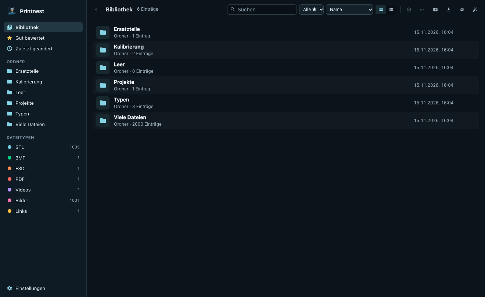
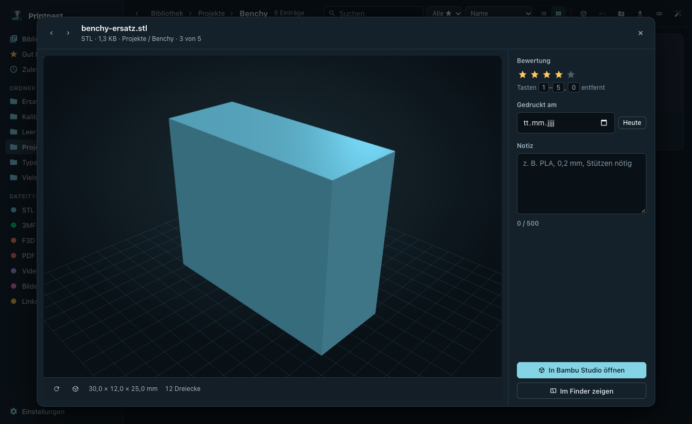
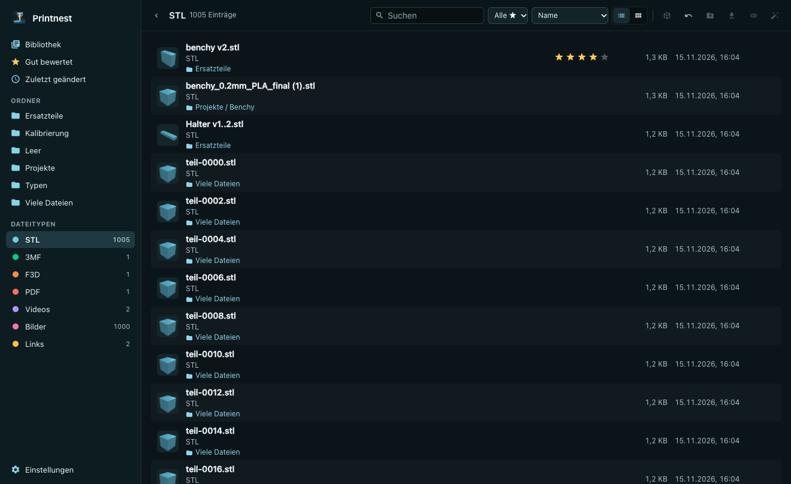
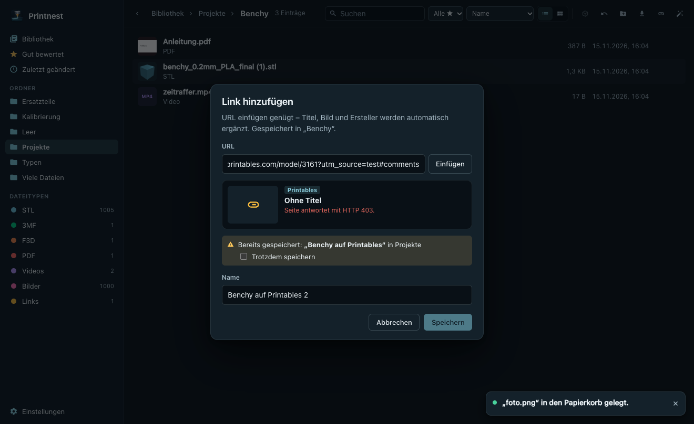

# Printnest

**Die lokale Bibliothek für deine 3D-Druck-Dateien – als native Mac-App.**

Printnest macht aus einem beliebigen Ordner auf deinem Mac eine übersichtliche Druck-Bibliothek:
STL, 3MF, F3D, PDF, Videos, Bilder und Links durchstöbern, mit der Leertaste wie im Finder ansehen,
Drucke mit Sternen bewerten und Dateien mit einem Klick in deinem Slicer öffnen.
Alles bleibt auf deinem Rechner – kein Konto, keine Cloud, keine Telemetrie.



| 3D-Vorschau | Farbprofil STL | Link-Assistent |
| --- | --- | --- |
|  |  |  |

## Download & Installation

1. Unter **[Releases](https://github.com/Lupova02/Printnest/releases/latest)** die Datei `Printnest-…-arm64.zip` herunterladen.
2. Entpacken und `Printnest.app` in den Ordner **Programme** ziehen.
3. Beim **ersten Start**: Rechtsklick auf die App → **Öffnen** → **Öffnen** bestätigen.
   Die App ist nicht bei Apple notarisiert, deshalb fragt macOS einmalig nach. Erscheint „App ist beschädigt“:
   ```bash
   xattr -dr com.apple.quarantine /Applications/Printnest.app
   ```
4. Bibliotheksordner wählen – fertig.

**Voraussetzungen:** macOS 12 oder neuer, Mac mit Apple-Chip (M1 oder neuer).

## Funktionen

- **Bibliotheksordner frei wählbar** (nativer macOS-Ordnerdialog)
- **Seitenleiste**: Bibliothek, oberste Ordner, Typfilter mit Farbpunkt und Anzahl, „Gut bewertet“, „Zuletzt geändert“
- **Liste und Raster, virtualisiert**: auch Ordner mit tausenden Dateien scrollen flüssig; Vorschaubilder
  (STL/3MF gerendert und gecacht, PDF, F3D, Bilder, Videos) laden nur im Sichtbereich, max. 3 parallel
- **Quick Look wie im Finder** (Leertaste öffnet und schließt): Liste ↑/↓, Raster ←/→ und ↑/↓ zeilenweise;
  STL/3MF im Web Worker geparst (Orbit, Zoom, Drahtgitter, Maße, Dreiecke, Vereinfachung sehr großer Netze),
  PDF mit Blättern/Zoom, Videos mit eigener Steuerleiste (K, M, F, ⇧←/⇧→)
- **Druck-Bewertung** 1–5 Sterne, Notiz und Druckdatum; Videos nur mit Notiz (Autosave)
- **Im Slicer öffnen**: 16 bekannte Slicer + eigene App; genau ein Standard-Slicer, nur dieser erscheint („In … öffnen“)
- **Farbprofile je Dateityp** (Hell/Dunkel, WCAG AA geprüft); Ordneransicht bleibt Eisblau
- **Link-Assistent**: URL einfügen → Titel, Bild, Portal und Ersteller automatisch; Duplikat- und Erreichbarkeitsprüfung
- **Namens-Assistent und Stapelumbenennung** mit Diff, Konflikterkennung, Ordner-Schemata und ⌘Z
- **Drag & Drop** aus dem Finder (Dateien und ganze Ordner, rekursiv; nicht unterstützte Typen werden gemeldet)
  und innerhalb der App (Eintrag auf Ordner, Seitenleiste oder Breadcrumb ziehen = verschieben)
- **Kontextmenü** (Rechtsklick, ⇧F10): Öffnen, Vorschau, Slicer, Umbenennen, Verschieben, Bewerten,
  Im Finder zeigen, Pfad kopieren, In den Papierkorb
- **Live-Aktualisierung**: Änderungen im Finder erscheinen sofort (fs.watch + Server-Sent Events)
- **Löschen in den Papierkorb** (wiederherstellbar), Import ohne Überschreiben („Name (2).stl“)
- Deutsche Menüleiste, Hell/Dunkel nach System, Toasts, Skeleton-Loader, dezente Animationen
  (respektiert „Bewegung reduzieren“), Tastaturbedienung und WCAG-AA-Kontraste

## Tastaturkürzel

| Kürzel | Aktion |
| --- | --- |
| ↑ ↓ (Raster auch ← →), ⇧ erweitert | Auswahl bewegen |
| ⌘-Klick / ⇧-Klick | Mehrfachauswahl |
| ↩ / ⌘↓ | Ordner öffnen bzw. Vorschau |
| Leertaste | Quick Look öffnen / schließen |
| In Quick Look: ↑ ↓ / ← → | Blättern (Liste) bzw. Datei / Zeile (Raster) |
| In Quick Look (Video): K, M, F, ⇧← / ⇧→ | Play/Pause, Ton, Vollbild, ±5 s |
| ⌘↑ | Eine Ebene höher |
| 1–5 / 0 | Bewerten / Bewertung entfernen |
| ⇧↩ / ⇧⌘R | Umbenennen / Stapelumbenennung |
| ⌘Z | Umbenennen/Verschieben widerrufen |
| ⌘⌫ | In den Papierkorb |
| ⇧⌘O (auch ⌘E) | Im Standard-Slicer öffnen |
| ⇧⌘A | Namens-Assistent |
| ⌥⌘R | Im Finder zeigen |
| ⇧⌘N / ⌘L / ⌘O | Neuer Ordner / Link hinzufügen / Dateien importieren |
| ⌘F | Suchen |
| ⌘1 / ⌘2 | Liste / Raster |
| ⌘R | Neu laden |
| ⌘, | Einstellungen |
| ⌘/ | Alle Tastaturkürzel |
| Esc | Dialog/Vorschau schließen, Suche leeren |

## Selbst bauen

Voraussetzung: Node.js 22 oder neuer.

```bash
npm ci
npm run electron:pack   # → release/mac-arm64/Printnest.app
npm run electron:dist   # → zusätzlich DMG
```

Die App wird **ad-hoc signiert** (`mac.identity: "-"`), damit sie per Doppelklick ohne „beschädigt“-Meldung startet.
Sie ist nicht notarisiert; beim allerersten Start ggf. Rechtsklick → Öffnen.

Ergebnis: `release/mac-arm64/Printnest.app` – nach `/Applications` ziehen.

## Entwicklung

```bash
npm start            # API (NODE_ENV=development, Port 3847) + UI (ng serve, Port 4200)
npm test             # Komponententests (ng test) + Server-Tests (Vitest)
npm run test:ui      # UI-Smoke-Test in Electron (vorher npm run build:web), Screenshots → docs/screenshots
npm run icon         # App-Icon aus assets/branding/printnest-icon.svg erzeugen
npm run themes       # Farbprofile neu erzeugen (scripts/themes.mjs → src/app/shared/styles/_themes.scss)
npm run electron:dev # gebaute UI in Electron starten
```

## Datenablage

| Was | Wo |
| --- | --- |
| Bibliothekspfad, Einstellungen (Standard-Slicer, eigene Slicer-Apps) | `~/Library/Application Support/Printnest/printnest-data/config.json` |
| Namens-Assistent (Ordner-Schemata, gelernte Korrekturen) | `…/printnest-data/name-assist.json` |
| UI-Zustand (letzter Ordner, Ansicht, Sortierung) | `…/printnest-data/ui-state.json` |
| Fensterposition/-größe | `~/Library/Application Support/Printnest/window-state.json` |
| Vorschau-Cache (PDF, F3D, STL/3MF-Thumbnails, Link-Bilder) | `…/printnest-data/.preview-cache/` |
| Links | `.printnest-links.json` im Bibliotheksordner |
| Bewertungen, Notizen, Druckdatum | `.printnest-meta.json` im Bibliotheksordner |

Links und Bewertungen liegen bewusst **in der Bibliothek**, damit sie mitwandern (z. B. bei iCloud/NAS).
Sie werden atomar geschrieben und beim Umbenennen/Verschieben/Löschen mitgezogen.
Im Browser-Dev-Modus liegt die Config in `server/config.json` (in `.gitignore`, Vorlage `server/config.example.json`).

## Sicherheit

- Die API lauscht nur auf `127.0.0.1`. Bei jedem App-Start wird ein zufälliges Token erzeugt, per Preload an die UI
  übergeben und bei jeder Anfrage als `X-Printnest-Token` geprüft (für Medien-URLs als `?token=`).
- `Host`- und `Origin`-Header werden geprüft (Schutz vor DNS-Rebinding und Fremdseiten), CORS ist abgeschaltet.
- Im Dev-Modus (`NODE_ENV=development`) entfällt nur die Token-Pflicht; mit `PRINTNEST_TOKEN=…` wird sie erzwungen.
- Pfade werden auf die Bibliothek beschränkt (kein Path-Traversal), Namen mit `/`, `\`, `:` und Steuerzeichen abgelehnt.
- Electron: Context Isolation, Sandbox, keine Node-Integration, Navigation nur innerhalb der App,
  IPC nur vom eigenen Origin.
- Link-Assistent: Metadaten holt der Server mit SSRF-Schutz (nur http/https, keine privaten/lokalen Adressen –
  geprüft beim Verbindungsaufbau und nach jeder Weiterleitung –, Timeout 5 s, Größenlimit). Die Zwischenablage
  wird nur nach Klick auf „Einfügen“ gelesen.

## Unterstützte Dateien

| Art | Endungen |
| --- | --- |
| Modelle | `.stl`, `.3mf`, `.f3d` (Slicer je nach Programm zusätzlich `.step`, `.stp`, `.obj`, `.amf`) |
| Dokumente | `.pdf` |
| Video | `.mp4` |
| Bilder | `.png`, `.jpg`, `.jpeg`, `.webp`, `.gif`, `.bmp`, `.tif`, `.tiff` |
| Links | gespeichert in `.printnest-links.json` |

## Mitmachen

Fehler gefunden oder eine Idee? Gerne ein [Issue](https://github.com/Lupova02/Printnest/issues) öffnen
oder einen Pull Request schicken.

## Lizenz

[MIT](LICENSE) – du darfst Printnest frei nutzen, verändern, weiterentwickeln und weitergeben.
